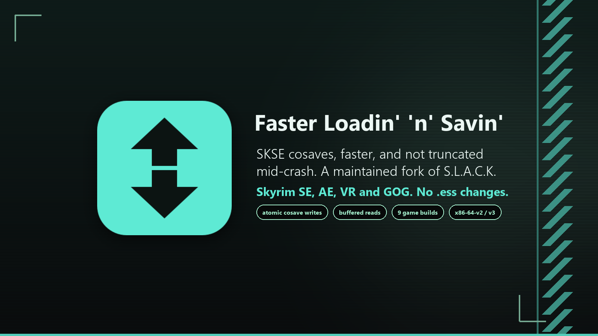

<div align="center">



[](https://github.com/SenjuWoo/Faster-Loadin-n-Savin/actions/workflows/ci.yml)
[](https://github.com/SenjuWoo/Faster-Loadin-n-Savin/releases/latest)
[](build.ps1)
[](#compatibility)
[](LICENSE)

**[Install](#install)** · **[Safety scope](#safety-scope)** · **[Verify a release](#verifying-releases)** · **[Build](#build)** · **[How it works](#how-it-works)** · **[Changelog](changelog.md)**

</div>

Faster Loadin' 'n' Savin' is a maintenance fork of
[S.L.A.C.K.](https://github.com/just-harry/save-load-accelerator-for-skse-cosaves) (Save and
Load Accelerator for SKSE Cosaves) by Harry Gillanders (`just-harry`). SKSE plugins serialize
into a **cosave** beside the `.ess`; upstream already made that path fast. This fork keeps that
work and stops the previous cosave from being truncated before its replacement has been fully
written. It accelerates SKSE cosave serialization and loading only, and does not touch Skyrim's
`.ess` format.

The public name was requested by the original author. Runtime filenames stay
`Save&LoadAcceleratorForSKSECosaves.dll` and `Save&LoadAcceleratorForSKSECosaves.ini`, because the
compiled plugin expects those names.

## What you get

- **Crash-safe cosave writes.** A new cosave goes to a sibling `.tmp` file and replaces the old one with `MoveFileExA(..., MOVEFILE_REPLACE_EXISTING | MOVEFILE_WRITE_THROUGH)` only after it is fully written. Upstream still truncates the cosave in place.
- **Simpler, faster loading.** Buffered, sequential reads of exactly the cosave's length, so the Windows page cache and read-ahead do their job.
- **Upstream's speed, kept.** Rebased on S.L.A.C.K. 1.3.4: SKSE's builtin preloader on 1.6.1170 and 1.7.99, and a friendly version-mismatch dialog instead of a silent failure.
- **Two CPU builds.** Universal x86-64-v2 is the FOMOD default; an optional High-End x86-64-v3 (AVX2-class) build overlays only the selected game version.
- **Releases you can check.** Every archive carries a DLL manifest and a SHA-256 sidecar, and `tools/verify-release-binaries.py` lists hashes, version resources, static imports and per-section differences.
- **No save surgery.** No cosave format change; nothing to clean when installing, updating or uninstalling.


*Upstream S.L.A.C.K.'s published measurement, not a benchmark of this fork. Results depend on
cosave size, storage, CPU and the installed SKSE plugins, and the plugin speeds up only the SKSE
cosave part of a save.*


## Safety scope

Atomic replacement means the previous cosave is not truncated before the new file has been fully
written and closed. That **reduces the risk of a destroyed or truncated SKSE cosave when saving is
interrupted**.

It is not a transaction spanning both the `.ess` and the SKSE cosave. It cannot guarantee that every
third-party SKSE serialization callback produced logically complete data. Experimental parallel
saving stays **disabled by default**: third-party callbacks cannot be assumed thread-safe.

## Install

Install the archive from the [latest release](https://github.com/SenjuWoo/Faster-Loadin-n-Savin/releases/latest)
with Mod Organizer 2, Vortex, or another FOMOD-capable manager.

1. Select the detected Skyrim runtime.
2. Keep **Universal (Recommended)** unless you deliberately want High-End.
3. Confirm the DLL is at `Data\DLLPlugins\Save&LoadAcceleratorForSKSECosaves.dll`.

High-End x86-64-v3 needs an AVX2-class CPU (AMD Zen 2+ or Intel Haswell+). It may provide little or
no measurable improvement, and on an older CPU it crashes with an illegal instruction.

Manual install: copy the DLL and INI for **exactly one** game version to `Data\DLLPlugins\`.
Universal files are in the archive's game-version folders. High-End files are under
`Optional\High-End (x86-64-v3)\<game-version>\DLLPlugins\`.

Remove the old version before switching CPU builds so two copies cannot deploy. See
[`INSTALL-NOTES.txt`](INSTALL-NOTES.txt).

## Compatibility

Standalone apart from SKSE. It does **not** require NextGen Disk Cache.

| FOMOD option | SKSE |
| --- | --- |
| Skyrim AE 1.7.99 | SKSE64 2.3.0 |
| Skyrim AE 1.6.1170 | SKSE64 2.2.8 |
| Skyrim AE 1.6.1130 | SKSE64 2.2.5 |
| Skyrim AE 1.6.640 | SKSE64 2.2.3 |
| Skyrim AE 1.6.353 | SKSE64 2.1.5 |
| Skyrim SE 1.5.97 | SKSE64 2.0.20 |
| Skyrim VR 1.4.15 | SKSEVR 2.0.12 |
| Skyrim AE 1.6.1179 (GOG) | SKSE64 2.2.6 (GOG) |
| Skyrim AE 1.6.659 (GOG) | SKSE64 2.2.3 (GOG) |

- 1.6.1170 and 1.7.99 builds use SKSE's builtin preloader (`SKSEPlugin_Preload`).
- Other variants still load from `Data\DLLPlugins\` and need a compatible DLL preloader (SSE Engine Fixes' preloader or DLL Plugin Loader).
- Parallel saving should stay disabled unless every participating SKSE plugin is known to be thread-safe during serialization.

## Configuration

The INI sits beside the DLL: `Data\DLLPlugins\Save&LoadAcceleratorForSKSECosaves.ini`.
Acceleration of saving and loading is on by default, timing lines go to the console, and
`[ParallelSaving] Enabled = false` keeps parallel saving off. Every key is documented in the
file itself.

## Verifying releases

`tools/verify-release-binaries.py` produces DLL manifests, inspects static imports, and compares PE sections:

```text
python tools/verify-release-binaries.py manifest <extracted-release>
python tools/verify-release-binaries.py imports <installed-dll>
python tools/verify-release-binaries.py compare <old-dll> <new-dll> --strict
```

Static imports are evidence, not proof of every capability a native binary could exercise.
Historical 1.5.1 `.text` identity vs 1.5.0 is documented in
[`VERIFYING-RELEASES.md`](VERIFYING-RELEASES.md); that file has not been restated for 1.6.0 and later.

## Build

Requirements:

- Windows PowerShell 5.1 or PowerShell 7+
- LDC (`ldc2`; CI uses 1.42.0)
- Windows SDK resource compiler (`rc.exe`)
- Clang C++ or MSVC `cl.exe`
- `lld-link` or MSVC `link.exe`
- Python 3.8+ for release verification

```powershell
./scripts/update-version-number.ps1 1.7.1.0
./package-release.ps1 -Version 1.7.1
```

`package-release.ps1` defaults to 1.7.1 and builds both CPU profiles for all nine game variants
unless `-SkipBuild` is passed. CI runs:

```powershell
./build.ps1 -BuildTag x86-64-v2 -TargetCPU x86-64-v2
./build.ps1 -BuildTag x86-64-v3 -TargetCPU x86-64-v3
./package-release.ps1
```

A pushed `v*` tag runs the same job and attaches the package to the GitHub release.
`package.ps1` is a compatibility wrapper around `package-release.ps1`; it no longer creates
PDB-bearing legacy packages.

## How it works


```text
mod/slack_mod/     plugin (save_load, setup, entrypoint, INI)
mod/skse64/        SKSE bindings + runtime patch offsets
mod/game/          Skyrim SE/AE/VR/GOG archetype detection
mod/slack_common/  betterC support library (no D runtime, no CRT)
mod/*.ini          default plugin INI
scripts/           version stamp
tools/             release binary verification
build.ps1          LDC + rc + link
package-release.ps1  both CPU profiles, FOMOD, hashes
```

## Honest status

Verified in this tree:

- `VERSION.txt` **1.7.1.0**, changelog **1.7.1**, packager default **1.7.1**
- Atomic `.tmp` + `MoveFileExA` replacement and buffered exact-length reads in source
- GitHub Actions CI that builds x86-64-v2 and x86-64-v3 and runs the release packager's gates

Not claimed:

- Acceleration of the main `.ess` save
- An atomic `.ess` + cosave transaction
- In-game load-time benchmarks of this fork (the timing image above is upstream's)
- That High-End x86-64-v3 is faster on any given load order

## Credits

**Save and Load Accelerator for SKSE Cosaves** was created by **Harry Gillanders (`just-harry`)**.

- Upstream: https://github.com/just-harry/save-load-accelerator-for-skse-cosaves
- This fork: https://github.com/SenjuWoo/Faster-Loadin-n-Savin

See [`CREDITS.md`](CREDITS.md) and [`LICENSE`](LICENSE). 0BSD permits use, copying, modification,
and redistribution with or without fee. Nexus permissions should mirror those terms.

## License

[0BSD](LICENSE). Release notes: [changelog.md](changelog.md).

---

## Hitchhiker's Guide to the Codebase

This software has been written using D in the style of a better C—but the abominable C runtime is not used—and the D runtime also is not used, and the D standard-library is mostly avoided.  
Thus, a great deal of this repository is my own non-standard-library, found in `mod/slack_common`.

### Map

- [`mod/slack_common`](mod/slack_common): This module deals with functionality that's more-or-less generic.
	- [`mod/slack_common/algorithms.d`](mod/slack_common/algorithms.d): Vaguely algorithmic logic.
	- [`mod/slack_common/bindings.d`](mod/slack_common/bindings.d): Bindings for the compilation target: in this case, Windows.
	- [`mod/slack_common/byte_sizes.d`](mod/slack_common/byte_sizes.d): Because `64.MB` is clearer than `64 << 20`.
	- [`mod/slack_common/cpp.d`](mod/slack_common/cpp.d): Some bindings for Visual C++'s STL.
	- [`mod/slack_common/dynamic_linking.d`](mod/slack_common/dynamic_linking.d): Some convenience functions for dynamically linking with exports.
	- [`mod/slack_common/dynamically_linked.d`](mod/slack_common/dynamically_linked.d): A bit of a bodge to make dynamically-linked symbols available to `slack_common` without presupposing a storage method/layout for the pointers.
	- [`mod/slack_common/file_handling.d`](mod/slack_common/file_handling.d): Does what it says on the tin.
	- [`mod/slack_common/ini.d`](mod/slack_common/ini.d): Simple INI file parsing (lexing, really).
	- [`mod/slack_common/integers.d`](mod/slack_common/integers.d): Functions and whatnot for dealing with integer values.
	- [`mod/slack_common/large_low_overhead_buffer.d`](mod/slack_common/large_low_overhead_buffer.d): Buffers optimised for low-overhead writing into large and re-used regions of memory.
	- [`mod/slack_common/parsing.d`](mod/slack_common/parsing.d): Straightforward parsing and lexing routines.
	- [`mod/slack_common/patching.d`](mod/slack_common/patching.d): Utilities for examining, generating, and rewriting x86 machine code.
	- [`mod/slack_common/pe.d`](mod/slack_common/pe.d): Functionality for inspecting Portable Executable images.
	- [`mod/slack_common/peb_access.d`](mod/slack_common/peb_access.d): Support for peeking inside the process's Process Environment Block.
	- [`mod/slack_common/simd.d`](mod/slack_common/simd.d): The basics for x86 SIMD usage.
	- [`mod/slack_common/sorting.d`](mod/slack_common/sorting.d): Functions which can sort any array so long as its length is three.
	- [`mod/slack_common/text.d`](mod/slack_common/text.d): Simple text manipulation routines, including UTF-8<->UTF-16 conversion.
	- [`mod/slack_common/threading.d`](mod/slack_common/threading.d): Functions for controlling and synchronising threads.
	- [`mod/slack_common/tib_access.d`](mod/slack_common/tib_access.d): Support for reading and writing from and to a thread's Thread Information Block.
	- [`mod/slack_common/timing.d`](mod/slack_common/timing.d): Time matters.
	- [`mod/slack_common/user_interface.d`](mod/slack_common/user_interface.d): Frankly, this is just for popping up an error-message box when something invariably goes pear-shaped.
	- [`mod/slack_common/versions.d`](mod/slack_common/versions.d): A bunch of `enum bool` definitions so that we can use `static if` instead of `version`.
- [`mod/game`](mod/game): This module provides some basic infrastructure for introspecting which version/archetype of Skyrim SE we're targeting.
- [`mod/skse64`](mod/skse64): This module provides a minimal set of bindings for SKSE.
	- [`mod/skse64/hacks`](mod/skse64/hacks): This module isn't for bindings but instead for data and functions that assist in patching SKSE at runtime.
		- [`mod/skse64/hacks/versioning.d`](mod/skse64/hacks/versioning.d): Very simple: version-numbers and file-names for the latest version of SKSE for a given archetype of Skyrim SE.
		- [`mod/skse64/hacks/offsets.d`](mod/skse64/hacks/offsets.d): A table of offsets for places to patch SKSE at runtime.
- [`mod/slack_mod`](mod/slack_mod): This module implements the actual plugin proper.
	- [`mod/slack_mod/configuration.d`](mod/slack_mod/configuration.d): Defines the configurable state for the plugin.
	- [`mod/slack_mod/entrypoint.d`](mod/slack_mod/entrypoint.d): The entrypoint for the plugin's DLL, as well as any DLL exports, and the assert handler for debug builds.
	- [`mod/slack_mod/exception_wrapper.cpp`](mod/slack_mod/exception_wrapper.cpp): A small wrapper for calling a function and catching any exceptions it may throw.
	- [`mod/slack_mod/exception_wrapper.d`](mod/slack_mod/exception_wrapper.d): D bindings for the C++ exception wrapper.
	- [`mod/slack_mod/global.d`](mod/slack_mod/global.d): All the global state for the plugin, traceable from once place, and the vectored-exception-handler.
	- [`mod/slack_mod/limits.d`](mod/slack_mod/limits.d): Provides the definitions for any hardcoded limits for the plugin's functionality.
	- [`mod/slack_mod/Save&LoadAcceleratorForSKSECosaves-DLLPluginLoader.def`](mod/slack_mod/Save&LoadAcceleratorForSKSECosaves-DLLPluginLoader.def) and [`mod/slack_mod/Save&LoadAcceleratorForSKSECosaves-SKSEPreloader.def`](mod/slack_mod/Save&LoadAcceleratorForSKSECosaves-SKSEPreloader.def): Define the exports of the plugin's DLL for the DLL Plugin Loader and SKSE preloader builds.
	- [`mod/slack_mod/Save&LoadAcceleratorForSKSECosaves.rc`](mod/slack_mod/Save&LoadAcceleratorForSKSECosaves.rc): Defines the product-version metadata for the plugin's DLL.
	- [`mod/slack_mod/save_load.d`](mod/slack_mod/save_load.d): The actual implementation of optimised saving and loading for SKSE cosave files.
	- [`mod/slack_mod/setup.d`](mod/slack_mod/setup.d): This file is responsible for installing the optimised saving/loading hooks at runtime, and generally setting up all the fiddly global state.
- [`mod/Save&LoadAcceleratorForSKSECosaves.ini`](mod/Save&LoadAcceleratorForSKSECosaves.ini): The default configuration file for the plugin.
